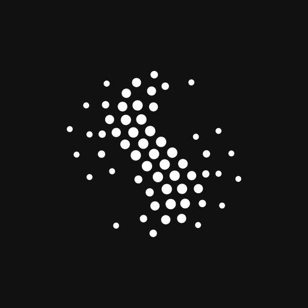

<div align="center">



# gen-art

**A flow-field particle system: 8,000 points tracing coherent noise.**

[](https://github.com/marcus-beauregard/gen-art/actions/workflows/ci.yml)
[](LICENSE)

</div>

## Run it

```bash
python3 -m http.server 8000
# then http://localhost:8000
```

Opening ```index.html``` directly also works; the server is the honest instruction because Three.js loads from a CDN. Reload for a new seed.

## What it does

Eight thousand particles accelerate along a curl-noise field and are damped each frame. The result looks like smoke obeying a rule you can almost see. Everything derives from the seed, so the same seed draws the same structure.

The frame step is clamped at 1/30s on purpose: a backgrounded tab must not teleport the field when it comes back.

## Develop

```bash
node --test      # six files: particles, motion, frustum, resize, viewport, framerate
node --check sketch.js
```

The tests run headlessly against a small double of the Three.js surface, so they assert behaviour rather than pixels.

## Contributing

Humans and automated agents are both welcome. There is no CLA — every commit carries a [DCO](https://developercertificate.org/) sign-off (**git commit -s**).

Start with a [good first issue](https://github.com/marcus-beauregard/gen-art/issues?q=is%3Aissue+is%3Aopen+label%3A%22good+first+issue%22), or read [CONTRIBUTING.md](CONTRIBUTING.md).

## Licence

GPL-2.0-or-later — see [LICENSE](LICENSE). Copyright (C) 2026 Marcus Beauregard.
